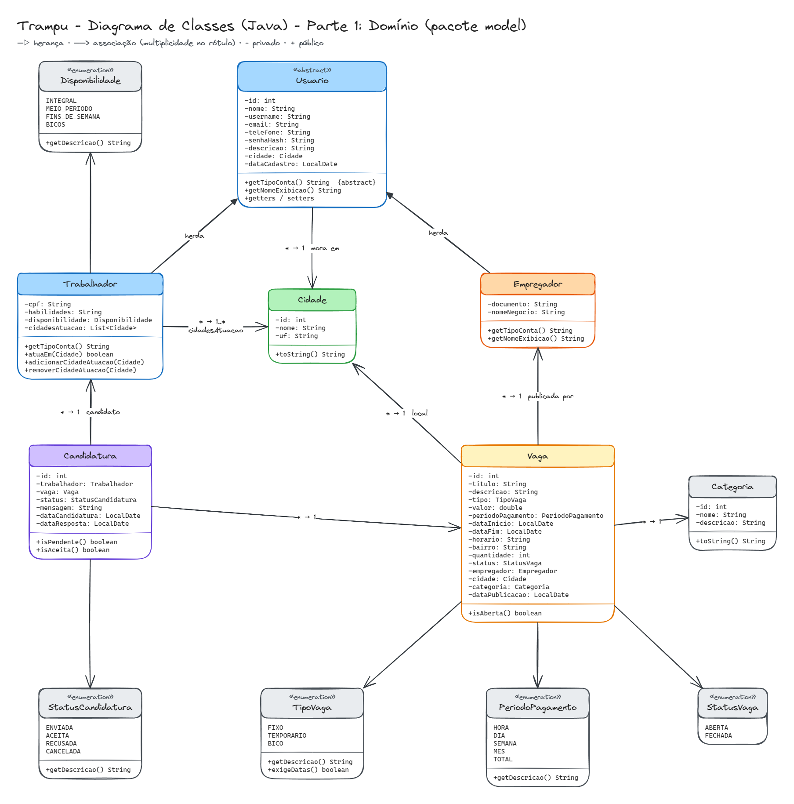
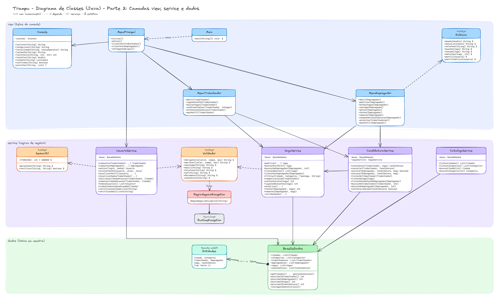
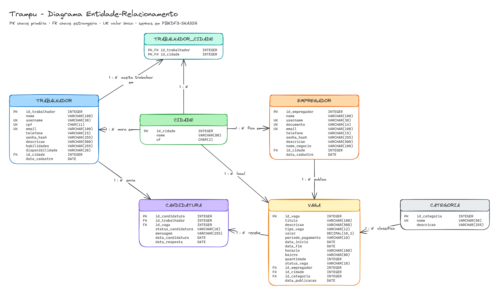
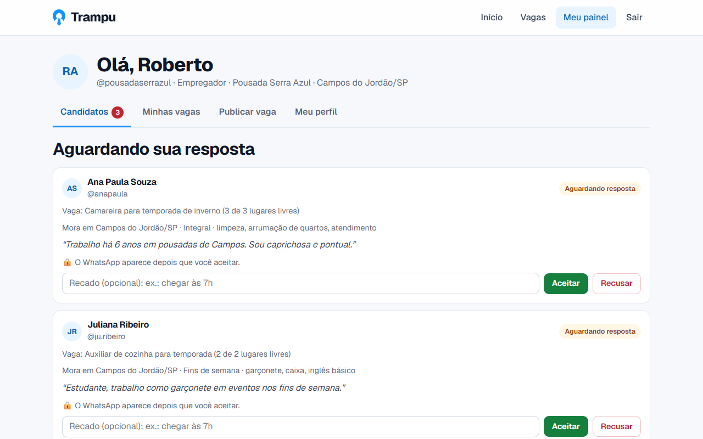
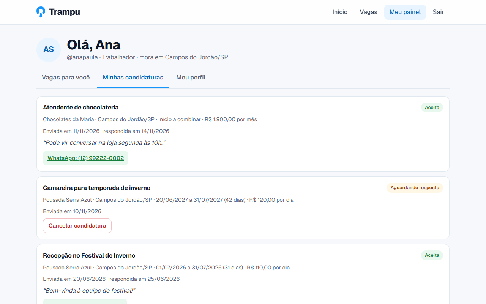
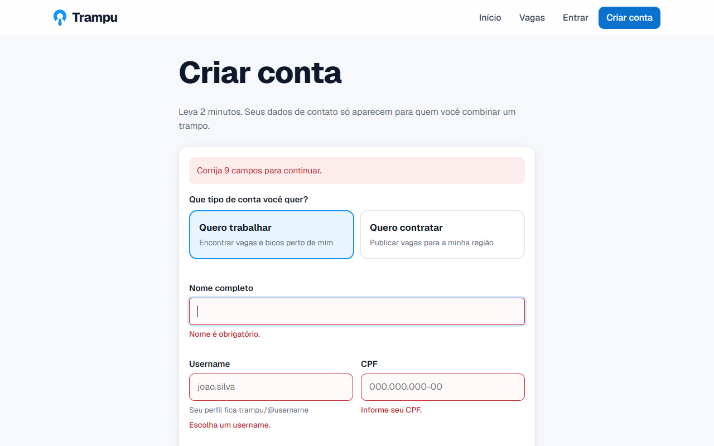
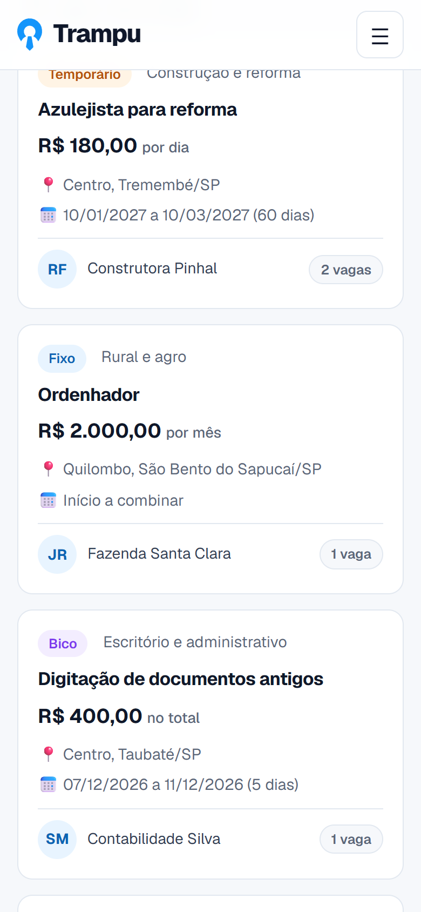

<p align="center">
  
</p>

<h1 align="center">Trampu</h1>

<p align="center">
  <strong>Trabalho perto de você.</strong><br>
  Plataforma que conecta quem precisa de trabalho a quem precisa contratar nas cidades pequenas.
</p>

<p align="center">
  Global Solution 2026/2 · <strong>CitizenTech</strong> · FIAP · Engenharia de Software
</p>

<p align="center">
  <a href="#">🌐 Protótipo no ar (GitHub Pages)</a> ·
  <a href="#">🎬 Vídeo pitch</a>
</p>

> ⚠️ **Antes de entregar:** troque os dois links acima, preencha a tabela de integrantes e confira a seção de uso de IA.

---

## Sumário

1. [Integrantes](#integrantes)
2. [A proposta](#a-proposta)
3. [Como o projeto atende ao edital](#como-o-projeto-atende-ao-edital)
4. [Estrutura do repositório](#estrutura-do-repositório)
5. [Como rodar](#como-rodar)
6. [Parte 1: Java POO](#parte-1-java-poo-6-pontos)
7. [Parte 2: Banco de dados](#parte-2-banco-de-dados-4-pontos)
8. [Parte 3: Protótipo web](#parte-3-protótipo-web-5-pontos)
9. [Segurança e privacidade](#segurança-e-privacidade)
10. [Diferenciais](#diferenciais)
11. [Tecnologias](#tecnologias)

---

## Integrantes

| Nome | RM |
|---|---|
| _Nome do integrante 1_ | _RM00000_ |
| _Nome do integrante 2_ | _RM00000_ |
| _Nome do integrante 3_ | _RM00000_ |

---

## A proposta

O edital pede que uma boa proposta deixe claros seis pontos. Respondemos cada um abaixo.

### 1. Quem é o cidadão beneficiado

Moradores de **cidades pequenas e da zona rural** da Serra da Mantiqueira e do Vale do Paraíba (Campos do Jordão, Santo Antônio do Pinhal, São Bento do Sapucaí, Monteiro Lobato, Sapucaí-Mirim, Pindamonhangaba, Taubaté e Tremembé). São dois públicos:

- **Quem quer trabalhar:** jovens no primeiro emprego, quem faz bico, trabalhador rural e quem busca renda extra na temporada.
- **Quem quer contratar:** pequenos negócios (pousadas, restaurantes, sítios, comércio) e pessoas físicas que precisam de uma diarista, um pedreiro ou um cuidador.

### 2. Qual problema será resolvido

Em cidade pequena, a vaga circula no **boca a boca**: no grupo de WhatsApp, no cartaz da padaria, no "conhece alguém?". Quem não está na rede certa não fica sabendo. Ao mesmo tempo:

- **A procura é sazonal.** Cidades turísticas como Campos do Jordão precisam de muita gente no inverno e de pouca no resto do ano.
- **Os grandes sites de emprego não atendem esse público.** Eles focam em vagas formais de cidade grande e não têm bico, diária nem trabalho rural.
- **A distância é uma barreira.** Muita gente aceitaria trabalhar na cidade vizinha, mas não sabe que lá tem vaga.

O resultado é renda que não chega a quem precisa e negócio que não acha quem contratar. Esse é o problema **"Comunidades isoladas"** e **"Dificuldade de acesso a serviços"** do desafio. A solução também se conecta às ideias **13, "Capacitação e inclusão produtiva conectadas às oportunidades reais de cada território"**, e **15, "Negócios de impacto que transformam problemas locais"**.

### 3. Como a solução vai funcionar

1. O **empregador** cria a conta e publica a vaga com valor, tipo (fixo, temporário ou bico), datas, horário, bairro e quantas pessoas precisa.
2. O **trabalhador** cria a conta e marca **as cidades onde aceita trabalhar**, que não precisam ser só a cidade onde mora.
3. A plataforma mostra ao trabalhador **as vagas que combinam com as cidades dele**. Ele se candidata em um clique.
4. O empregador vê quem se candidatou (nome, cidade, habilidades e disponibilidade) e **aceita ou recusa com um recado**.
5. **Só depois do aceite** o WhatsApp de um aparece para o outro. Quando todos os lugares são preenchidos, **a vaga fecha sozinha** e as candidaturas pendentes são recusadas automaticamente.

### 4. Quais tecnologias serão usadas

Nesta entrega, a solução está modelada em três partes separadas, como pede o edital: **Java** (console), **banco relacional** (SQL) e **web** (HTML, CSS e JavaScript puro). Veja [Tecnologias](#tecnologias).

### 5. Quem participa do ecossistema

| Participante | Papel |
|---|---|
| Trabalhadores | Encontram trabalho perto de casa e na região |
| Empregadores (negócios e pessoas físicas) | Encontram mão de obra local com rapidez |
| Prefeituras e secretarias de trabalho | Podem divulgar a plataforma e usar os dados para entender a demanda da região |
| Associações comerciais e de turismo | Mobilizam os negócios locais, principalmente antes da alta temporada |
| Escolas técnicas e cursos | Podem oferecer cursos alinhados com as vagas mais procuradas |

### 6. Como o impacto será medido e ampliado

**Indicadores** que o próprio banco já permite calcular (veja as [consultas SQL](#consultas-que-respondem-perguntas)):

- vagas abertas e pessoas contratadas por cidade e por categoria;
- tempo entre a publicação da vaga e o primeiro aceite;
- quantos trabalhadores conseguiram trabalho **fora da cidade onde moram**;
- valor médio pago por dia em cada área.

**Para ampliar:** começar por Campos do Jordão antes da temporada de inverno, expandir para as cidades vizinhas e depois replicar o modelo em outras regiões turísticas e rurais.

### Conexão com os ODS da ONU

| ODS | Como a Trampu contribui |
|---|---|
| **10 · Redução das desigualdades** | Dá acesso a oportunidades de renda a quem está fora das redes de contato e longe dos grandes centros |
| **11 · Cidades e comunidades sustentáveis** | Fortalece a economia local e reduz a necessidade de migrar para cidades grandes em busca de trabalho |
| **8 · Trabalho decente e crescimento econômico** (complementar) | Torna transparentes o valor, o horário e as condições de cada vaga antes do combinado |

---

## Como o projeto atende ao edital

| Critério do edital | Pontos | Onde está |
|---|:-:|---|
| **Java:** diagrama de classes (UML) | 1 | [`diagramas/diagrama-classes-1-dominio.png`](diagramas/diagrama-classes-1-dominio.png) e [`diagrama-classes-2-camadas.png`](diagramas/diagrama-classes-2-camadas.png) |
| **Java:** entidades bem modeladas | 1 | 8 classes de domínio e 5 enums em [`java/src/br/com/trampu/model`](java/src/br/com/trampu/model), com atributos privados, construtores, getters/setters, herança e associações |
| **Java:** CRUD pelo menu do console | 2 | Cadastro, listagem, busca, atualização **e remoção** (desafio extra) de vagas, candidaturas e perfis, com dados em `ArrayList` |
| **Java:** camadas separadas | 1 | Pacotes `model` (entidades), `service` (regras e validações), `dados` (listas) e `view` (menus) |
| **Java:** validações | 1 | `Validador` e `RegraNegocioException`: entradas inválidas mostram mensagem clara e o programa não quebra |
| **Banco:** diagrama ER | 2 | [`diagramas/diagrama-er.png`](diagramas/diagrama-er.png): 7 tabelas com PK, FK e cardinalidades |
| **Banco:** script `.sql` | 2 | [`banco/trampu.sql`](banco/trampu.sql): CREATE TABLE com PK, FK, NOT NULL, UNIQUE e CHECK, mais INSERTs. **Roda sem erro** |
| **Web:** navegação | 1 | 5 páginas com o mesmo menu e HTML semântico |
| **Web:** interatividade com dados | 2 | Dados em arrays de objetos ([`web/js/dados.js`](web/js/dados.js)), exibidos e filtrados pelo DOM |
| **Web:** formulário com validação | 1 | Cadastro, login, perfil e publicação de vaga validados em JS, com mensagens na página |
| **Web:** responsivo e bem desenhado | 1 | Funciona no celular e no computador; contraste conferido pelo padrão WCAG |
| **Regra:** um domínio, três partes | — | As **mesmas entidades e os mesmos dados** (8 cidades, 14 categorias, 6 trabalhadores, 28 empregadores, 130 vagas e 15 candidaturas) no Java, no banco e na web |
| **Regra:** sem frameworks | — | Java puro, SQL padrão e HTML/CSS/JS sem bibliotecas |

---

## Estrutura do repositório

```
trampu/
├── README.md
├── banco/
│   └── trampu.sql                    # script do banco (tabelas, dados e consultas)
├── diagramas/
│   ├── diagrama-er.png               # diagrama entidade-relacionamento
│   ├── diagrama-classes-1-dominio.png
│   ├── diagrama-classes-2-camadas.png
│   ├── *.excalidraw                  # versões editáveis (abrir em excalidraw.com)
│   └── mermaid/                      # mesmos diagramas em formato Mermaid
├── java/
│   └── src/br/com/trampu/
│       ├── Main.java
│       ├── model/                    # entidades e enums
│       ├── service/                  # regras de negócio e validações
│       ├── dados/                    # "banco" em memória (ArrayList)
│       └── view/                     # menus do console
├── web/
│   ├── index.html  vagas.html  cadastro.html  entrar.html  painel.html
│   ├── css/estilo.css
│   ├── js/                           # dados.js, comum.js e um script por página
│   └── img/
└── docs/telas/                       # prints usados neste README
```

---

## Como rodar

### Contas de teste

Todas as contas de exemplo usam a senha **`Trampu@123`**, no Java e na web.

| Tipo | Username | Quem é |
|---|---|---|
| Trabalhadora | `anapaula` | Ana Paula, camareira em Campos do Jordão |
| Trabalhador | `carlinhos.lima` | Carlos, jardineiro em Santo Antônio do Pinhal |
| Empregador | `pousadaserrazul` | Roberto, dono da Pousada Serra Azul |
| Empregador | `fazendasantaclara` | Joaquim, da Fazenda Santa Clara em São Bento |

### Java (console)

Requer o **JDK 17 ou mais novo** (testado com o 21). Dentro da pasta `java`:

```bash
# Git Bash, Linux ou macOS
javac -encoding UTF-8 -d out $(find src -name "*.java")
java -cp out br.com.trampu.Main
```

```powershell
# PowerShell
javac -encoding UTF-8 -d out (Get-ChildItem -Recurse src -Filter *.java).FullName
java -cp out br.com.trampu.Main
```

> No Windows, se os acentos aparecerem quebrados, rode `chcp 65001` antes do `java`.

### Banco de dados

O script foi escrito e testado no **SQLite 3**. Dentro da pasta `banco`:

```bash
sqlite3 trampu.db ".read trampu.sql"
```

Sem o `sqlite3` instalado, dá para usar o Python, que já vem com SQLite:

```bash
python -c "import sqlite3; c=sqlite3.connect('trampu.db'); c.executescript(open('trampu.sql',encoding='utf-8').read()); print('ok')"
```

Para ver as tabelas com interface gráfica, abra o `trampu.db` no [DB Browser for SQLite](https://sqlitebrowser.org/).

> **Oracle (SQL Developer / Live SQL):** o mesmo script roda no Oracle. Execute antes `ALTER SESSION SET NLS_DATE_FORMAT = 'YYYY-MM-DD';` para as datas serem lidas corretamente.

### Web

**Basta abrir `web/index.html` no navegador.** Não precisa de servidor nem de instalação. Também está no ar pelo GitHub Pages (link no topo).

---

## Parte 1: Java POO (6 pontos)

Sistema no console com menus para os dois tipos de conta. Os dados ficam em listas (`ArrayList`) carregadas com os mesmos exemplos do banco.

### Diagrama de classes

**Parte 1: domínio** (pacote `model`): herança `Usuario` → `Trabalhador` / `Empregador`, associações com multiplicidade e enums.



**Parte 2: camadas** (`view` → `service` → `dados`).



### Camadas

| Pacote | Responsabilidade | Classes |
|---|---|---|
| `model` | Entidades do domínio | `Usuario` (abstrata), `Trabalhador`, `Empregador`, `Cidade`, `Categoria`, `Vaga`, `Candidatura` e os enums `TipoVaga`, `PeriodoPagamento`, `StatusVaga`, `StatusCandidatura`, `Disponibilidade` |
| `service` | Regras de negócio e validações | `UsuarioService`, `VagaService`, `CandidaturaService`, `CatalogoService`, `Validador`, `SenhaUtil`, `RegraNegocioException` |
| `dados` | Armazenamento em memória | `BaseDeDados` (listas e geração de IDs) |
| `view` | Interação com o usuário | `MenuPrincipal`, `MenuTrabalhador`, `MenuEmpregador`, `Console`, `Exibicao` |

O menu **nunca acessa as listas diretamente**: ele chama um *service*, que valida e aplica as regras.

### CRUD pelo menu

| Operação | Trabalhador | Empregador |
|---|---|---|
| **Cadastro (Create)** | Criar conta; candidatar-se a uma vaga | Criar conta; publicar vaga |
| **Listagem (Read)** | Vagas nas minhas cidades; minhas candidaturas | Minhas vagas; candidaturas pendentes |
| **Busca (Read)** | Buscar vagas por cidade, categoria, tipo e texto | Ver vaga e candidatos; encontrar trabalhadores por cidade |
| **Atualização (Update)** | Editar perfil, habilidades, disponibilidade e cidades; alterar senha | Editar vaga; aceitar ou recusar candidaturas; editar perfil |
| **Remoção (Delete)** | Cancelar candidatura; remover cidade de trabalho | Fechar vaga; **remover vaga** |

### Regras de negócio

- Username e e-mail são **únicos entre os dois tipos de conta**.
- Vagas **fixas** não têm datas; vagas **temporárias e bicos** exigem início e fim, e o fim não pode ser antes do início.
- O **valor é obrigatório** e maior que zero, sempre com o período (hora, dia, semana, mês ou total).
- Não dá para se candidatar duas vezes à mesma vaga, nem a uma vaga fechada.
- O empregador **não aceita mais pessoas do que a vaga pede**. Quando lota, a vaga **fecha sozinha** e as candidaturas pendentes são recusadas com aviso.
- Uma vaga com pessoas já aceitas **não pode ser removida**, só fechada, para preservar o histórico.
- O **contato** (telefone e e-mail) só aparece depois que a candidatura é aceita.

### Validações

Toda entrada passa pela classe `Validador` (obrigatório, tamanho máximo, username, e-mail, telefone, CPF, CPF/CNPJ e senha forte). Quando algo está errado, o *service* lança `RegraNegocioException` com uma mensagem clara, e o menu mostra o erro e pede de novo. Números e datas inválidos também são tratados: **o programa não quebra**.

---

## Parte 2: Banco de dados (4 pontos)

### Diagrama entidade-relacionamento



### Tabelas

| Tabela | O que guarda | Relacionamentos |
|---|---|---|
| `CIDADE` | Cidades atendidas | 1:N com trabalhador, empregador e vaga |
| `CATEGORIA` | Áreas de trabalho, com descrição | 1:N com vaga |
| `TRABALHADOR` | Quem procura trabalho | N:1 com cidade (onde mora) |
| `TRABALHADOR_CIDADE` | Cidades onde o trabalhador aceita trabalhar | Tabela associativa N:N entre trabalhador e cidade |
| `EMPREGADOR` | Quem contrata (pessoa física ou negócio) | N:1 com cidade |
| `VAGA` | Oportunidades publicadas | N:1 com empregador, cidade e categoria |
| `CANDIDATURA` | Quem se candidatou a qual vaga e a resposta | N:1 com trabalhador e com vaga |

### Restrições

O script usa **37 restrições nomeadas**:

- **PRIMARY KEY** em todas as tabelas. `TRABALHADOR_CIDADE` tem chave composta.
- **FOREIGN KEY** em todos os relacionamentos.
- **NOT NULL** nos campos obrigatórios.
- **UNIQUE**: username, e-mail, CPF e documento; nome da cidade com a UF; e o par trabalhador e vaga, que impede candidatura duplicada.
- **CHECK**:
  - tipo, período e status só aceitam os valores previstos;
  - `valor > 0` e `quantidade > 0`;
  - username com 3 a 30 caracteres;
  - documento com 11 (CPF) ou 14 (CNPJ) dígitos;
  - vaga fixa não tem datas, temporária e bico exigem início e fim, e o fim vem depois do início;
  - a data de resposta é obrigatória quando a candidatura foi respondida.

### Dados de exemplo

| Tabela | Linhas |
|---|---:|
| Cidades | 8 |
| Categorias | 14 |
| Trabalhadores | 6 |
| Cidades de atuação | 16 |
| Empregadores | 28 |
| Vagas | 130 (125 abertas) |
| Candidaturas | 15 |

As vagas cobrem **as 14 categorias e as 8 cidades**, com 65 fixas, 28 temporárias e 37 bicos.

### Consultas que respondem perguntas

No fim do script há **6 consultas com JOIN** que respondem perguntas do domínio:

1. Quais vagas estão abertas, de quem são e onde?
2. Quais vagas combinam com as cidades em que a Ana aceita trabalhar?
3. Quem se candidatou às vagas da Pousada Serra Azul e em que situação está?
4. Quantas vagas abertas existem em cada cidade, incluindo as cidades sem vaga (`LEFT JOIN`)?
5. Quantos lugares ainda restam em cada vaga aberta?
6. Quais categorias têm mais vagas e qual o valor médio pago por dia?

---

## Parte 3: Protótipo web (5 pontos)

HTML, CSS e JavaScript **puros**, sem frameworks nem bibliotecas. Abre direto no navegador.

| Computador | Celular |
|---|---|
|  |  |

### Navegação

São **5 páginas** com o **mesmo menu**. No celular, o menu vira um botão.

| Página | Para quê |
|---|---|
| `index.html` | Início: busca rápida, números da plataforma, vagas recentes e categorias |
| `vagas.html` | Lista de vagas com filtros e detalhe da vaga |
| `cadastro.html` | Criar conta de trabalhador ou de empregador |
| `entrar.html` | Login por username ou e-mail |
| `painel.html` | Área logada, que muda conforme o tipo de conta |

O HTML é semântico: `header`, `nav`, `main`, `section`, `article`, `aside`, `footer`, `dialog`, `form`, `fieldset` e `label`. A página atual fica marcada no menu com `aria-current`.

### Interatividade com dados

Os dados ficam em **arrays de objetos** em [`web/js/dados.js`](web/js/dados.js), com os mesmos registros do banco e do Java. As páginas são montadas pelo **DOM** a partir desses arrays.

- **Filtros de vagas:** texto (ignora acentos: "garcom" acha "garçom"), cidade, área e tipo, mais três ordenações.
- **Painel do trabalhador:** vagas das cidades dele, candidaturas com o status e o contato liberado depois do aceite, e edição do perfil.
- **Painel do empregador:** responder candidatos, gerenciar vagas, publicar vaga e editar o perfil.
- **Persistência:** as alterações ficam salvas no navegador (`localStorage`). Um botão no rodapé restaura os dados de exemplo.

| Filtros e lista | Detalhe da vaga |
|---|---|
|  |  |

| Painel do empregador | Painel do trabalhador |
|---|---|
|  |  |

### Formulários com validação

Quatro formulários são validados em JavaScript, **com as mensagens na própria página** e sem `alert()`:

| Formulário | Validações |
|---|---|
| Cadastro | Nome; username (formato e único); CPF ou CNPJ; e-mail (formato e único); telefone com DDD; senha forte e confirmação; cidade; pelo menos uma cidade de trabalho; disponibilidade |
| Login | Campos obrigatórios; usuário ou senha incorretos, com a mesma mensagem nos dois casos |
| Perfil | As mesmas regras do cadastro, permitindo manter o próprio username e e-mail |
| Publicar vaga | Título, descrição, valor maior que zero, período, quantidade, cidade e área; datas obrigatórias para temporário e bico, sem data no passado e com o fim depois do início |

A mensagem aparece embaixo de cada campo assim que a pessoa sai dele, e no envio aparece um resumo como "Corrija 3 campos".



### Responsivo e bem desenhado

- O layout é pensado primeiro para o celular. Foi testado com **390px** de largura (celular) e **1280px** (computador), sem rolagem lateral.
- O **contraste** do texto foi conferido pelo padrão WCAG, com mínimo de 4,5:1.
- A navegação funciona pelo teclado, com foco visível e rótulos em todos os campos.
- Fonte Geist, com cores por tipo de vaga: azul para fixo, laranja para temporário e roxo para bico.

<p align="center">
  
</p>

---

## Segurança e privacidade

- **Senhas nunca em texto.** Elas são guardadas como **PBKDF2-HMAC-SHA256**, com *salt* aleatório e 600.000 iterações, no formato `pbkdf2_sha256$iterações$salt$hash`. O formato é o mesmo no banco, no Java (`javax.crypto`) e na web (`crypto.subtle`), então qualquer parte confere a senha criada pela outra.
- **Contato só depois do aceite.** Telefone e e-mail não aparecem para ninguém até o empregador aceitar a candidatura.
- **Login sem dar pistas.** A mensagem é a mesma para usuário inexistente e senha errada.
- **Nada digitado vira HTML.** Na web, todo texto entra na página por `textContent`, o que evita injeção de código.

---

## Diferenciais

| Diferencial do edital | Situação |
|---|---|
| Repositório no GitHub com commits de todos | _A fazer: cada integrante deve ter commits_ |
| Web publicada no GitHub Pages | _A fazer: publicar a pasta `web/` e colocar o link no topo_ |
| Consultas SQL com JOIN | ✅ 6 consultas no fim de [`banco/trampu.sql`](banco/trampu.sql) |
| Validado com gente real | _A fazer: registrar aqui com quem conversaram e o que mudou_ |

### Validação com gente real

> _Preencher: com quem o grupo conversou (por exemplo, donos de pousada, trabalhadores de temporada), o que essas pessoas disseram e o que mudou no projeto por causa disso._

---

## Tecnologias

| Parte | Tecnologia |
|---|---|
| Java | Java (JDK 17+), apenas a biblioteca padrão: `java.util`, `java.time`, `javax.crypto` |
| Banco | SQL padrão, executado no SQLite 3 (compatível com Oracle) |
| Web | HTML5, CSS3 e JavaScript puro. Fonte Geist pelo Google Fonts |
| Diagramas | Excalidraw (versões editáveis em `.excalidraw`) e Mermaid |