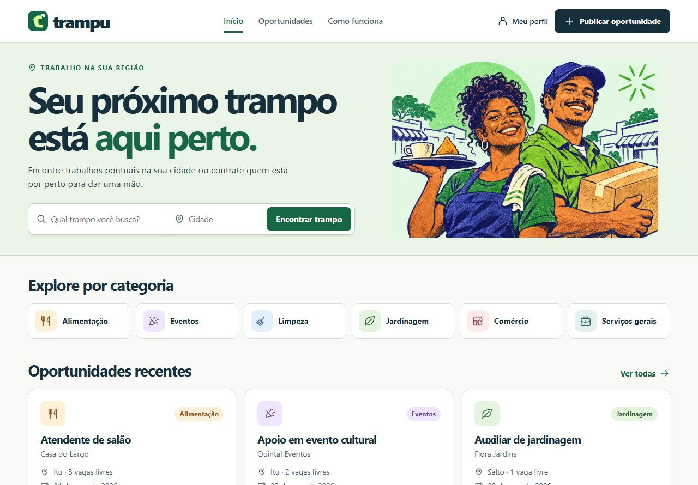
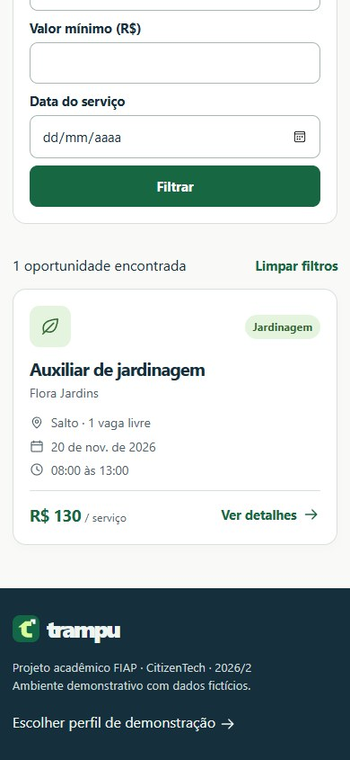
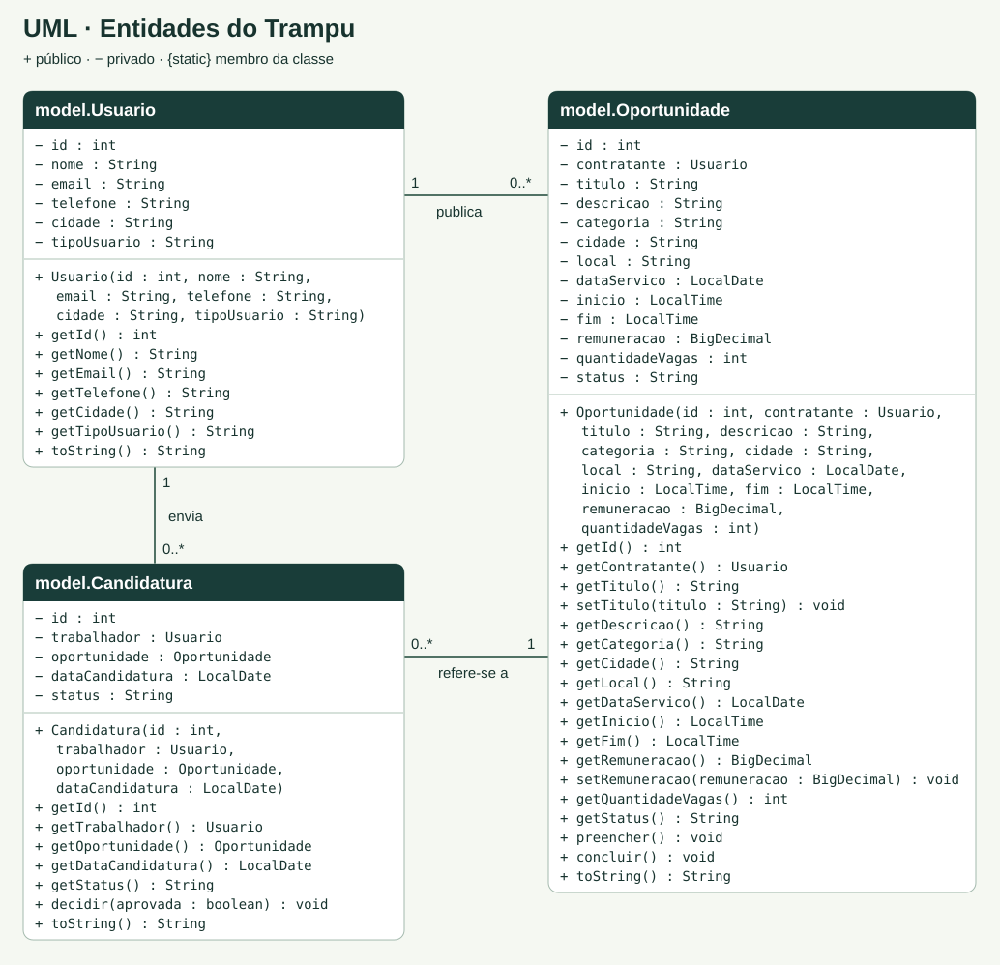
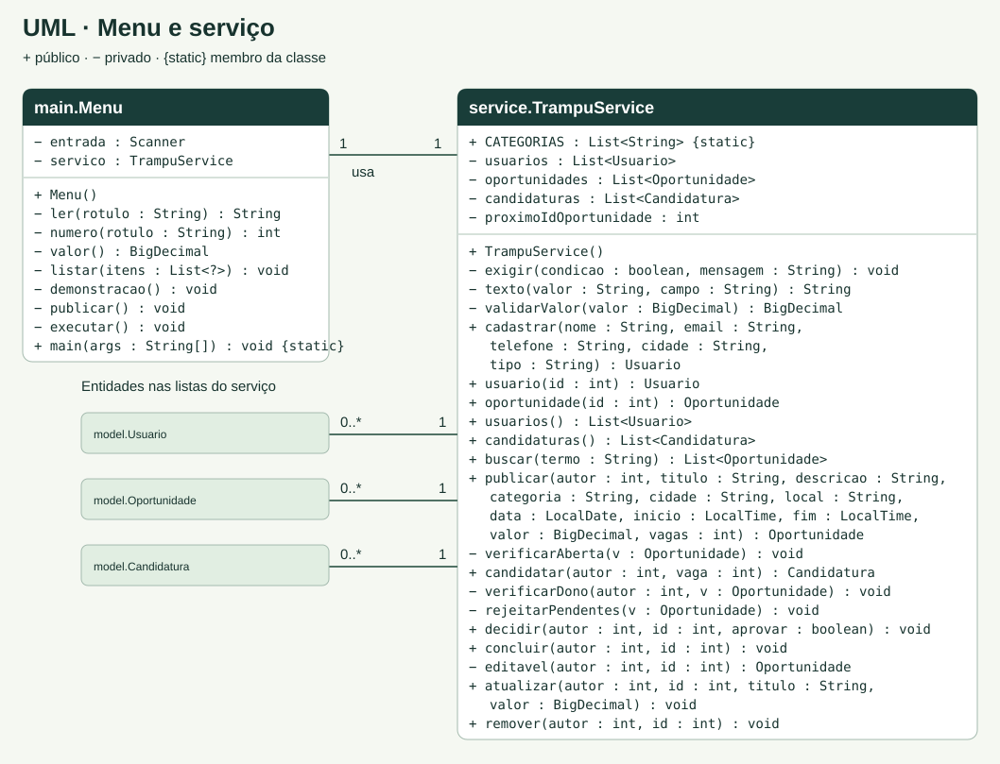
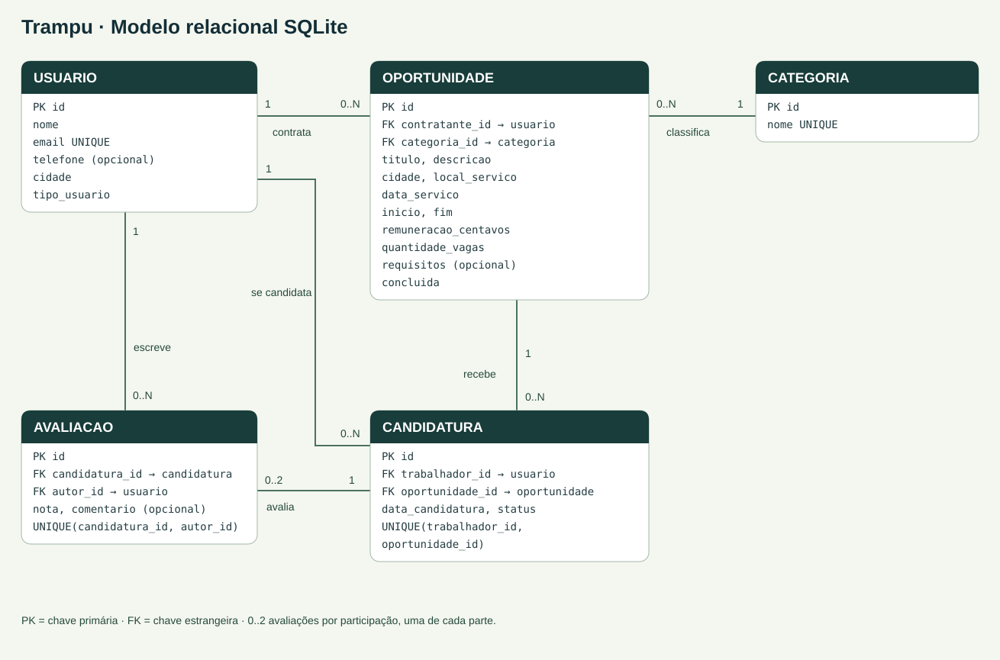

# Trampu

**Seu próximo trampo está mais perto do que você imagina.**

Uma diária de jardinagem pode estar disponível a poucas quadras de quem procura trabalho. Quando a divulgação depende de indicações, essa pessoa pode nunca saber da oportunidade. O Trampu reúne serviços temporários por cidade, categoria, data e remuneração. Trabalhadores podem manifestar interesse e acompanhar a decisão. Pequenos negócios, famílias e organizadores podem formar equipes para um turno.

Projeto acadêmico de Engenharia de Software para a **Global Solution FIAP 2026/2 · CitizenTech**. [Tema público da FIAP](https://experience.fiap.com.br/global-solution-citizen-tech)

[Equipe](#equipe) · [Critérios da FIAP](#critérios-da-fiap) · [Protótipo web](#protótipo-web) · [Diagramas](#diagramas) · [Console Java](#console-java) · [Banco SQLite](#banco-sqlite) · [Vídeo pitch](#vídeo-pitch)

[Baixar o ZIP da entrega](TRAMPU-FIAP.zip) · [Identificação do grupo](TRAMPU/integrantes.txt)

## Equipe

**Grupo Trampu** · Engenharia de Software · Turma 2ESOR

| Integrante | RM |
|---|---|
| Erick Marilhano | 575534 |
| Matheus Audibert | 568080 |
| Arthur Furkim Machado | 567608 |
| Thiago Augusto Saccomani | 566731 |
| Eder Felipe Dias de Jesus | 568341 |

## Critérios da FIAP

| Parte | Critério | Pontos possíveis | Como conferir |
|---|---|---:|---|
| Java | Diagrama de classes | 1 | Compare as três classes de domínio e as duas classes de aplicação com as [duas vistas do UML](#diagramas). |
| Java | Entidades bem modeladas | 1 | As [entidades](TRAMPU/java/src/model) têm atributos privados e construtores. Há acesso por getters, setters para o título e o valor e associações por referências a objetos. |
| Java | CRUD pelo menu | 2 | No [menu](TRAMPU/java/src/main/Menu.java), use 3 para publicar, 4 para listar, 5 para buscar, 6 para atualizar e 7 para remover uma publicação aberta sem candidaturas. |
| Java | Camadas separadas | 1 | O menu recebe a entrada, o [serviço](TRAMPU/java/src/service/TrampuService.java) aplica as regras e as entidades representam os dados. |
| Java | Validações | 1 | Digite letras em uma opção numérica ou tente candidatar a mesma pessoa duas vezes. O console explica o erro e volta ao menu. |
| Banco | Diagrama ER | 2 | Confira cinco tabelas, chaves e cardinalidades no [DER](TRAMPU/diagramas/der/relacionamentos.svg). |
| Banco | Script SQL | 2 | Execute o [script](TRAMPU/banco/trampu.sql) em um banco novo. Ele cria tabelas, aplica PK, FK, NOT NULL, UNIQUE e CHECK, insere exemplos e executa consultas. |
| Web | Navegação | 1 | Abra a página inicial e siga os links para oportunidades, detalhes e cadastro. As [sete páginas](TRAMPU/web) compartilham o menu. |
| Web | Interatividade com dados | 2 | Filtre por Salto e Jardinagem. O [código da busca](TRAMPU/web/js/interface.js) atualiza os cards no DOM a partir dos [arrays de objetos](TRAMPU/web/js/dominio.js). |
| Web | Formulário com validação | 1 | Envie um cadastro vazio e confira a mensagem de erro na própria página. [Formulários e eventos](TRAMPU/web/js/fluxos.js) |
| Web | Responsividade e design | 1 | Compare a navegação, as categorias e os cards em larguras de celular e computador. [Capturas do protótipo](#protótipo-web) |
| Pitch | Problema e cidadão (1), demonstração das três partes (2), impacto e diferencial (1), clareza e tempo (1) | 5 | O grupo vai gravar o protótipo em funcionamento. [Roteiro de gravação](TRAMPU/PITCH.md) |

## Protótipo web

A página inicial reúne os serviços por categoria. Na busca, uma pessoa pode combinar cidade, categoria, data e remuneração mínima. O card informa o valor por pessoa, o turno e quantas vagas ainda estão abertas.



<details>
<summary>Ver o resultado da busca por jardinagem em Salto no celular</summary>



</details>

## Abrir o protótipo

Depois de extrair o ZIP, abra `web/index.html` dentro da pasta **TRAMPU** para explorar o site no navegador. Para a demonstração com os dois perfis em abas diferentes, abra um terminal nessa pasta, execute o comando abaixo com Node.js e mantenha a janela aberta.

```sh
node servir.cjs
```

Acesse [Trampu no navegador](http://127.0.0.1:8080). O servidor entrega os arquivos estáticos da pasta web pela interface local, sem instalação de pacotes. Como alternativa, com Python 3, execute `python -m http.server 8080 --bind 127.0.0.1 --directory web` na mesma pasta. Use sempre a mesma origem para compartilhar as simulações entre páginas.

### Demonstração em dois perfis

1. Entre em **Meu perfil**. Escolha **Joana Lima** em **Usar um perfil existente**.
2. Em **Oportunidades**, filtre por **Salto** e **Jardinagem**. Abra **Auxiliar de jardinagem**, confira o valor individual e clique em **Candidatar-me**. No painel de Joana, a candidatura aparece como **Pendente**.
3. Abra uma segunda aba no mesmo endereço. Em **Trocar perfil de demonstração**, escolha **Flora Jardins**. No painel, abra **Ver candidatos** e aprove Joana. A única posição fica ocupada e a publicação passa a **Preenchida**. Volte ao painel de Joana para conferir a resposta.
4. Para experimentar a conclusão hoje, use **Quintal Eventos**. A publicação **Montagem de feira** representa um serviço de ontem com Joana já aprovada. Clique em **Concluir oportunidade**, abra os candidatos e avalie Joana. Ela pode ver a nota e avaliar a experiência em **Histórico e avaliações**.
5. Para começar do zero com uma nova oportunidade, crie um perfil de contratante e use **Publicar oportunidade**. Informe uma data e início futuros, o horário final do mesmo dia, o valor por pessoa e o número de vagas. A nova publicação entra na busca imediatamente.

As datas iniciais são relativas à primeira abertura. Dados de exemplo, perfis criados, inscrições e avaliações ficam no `localStorage` dessa origem. Cada aba guarda o perfil demonstrativo em `sessionStorage`. Para uma nova demonstração com datas atualizadas, use uma janela privada nova. As avaliações de exemplo são fictícias.

## Arquitetura

| Parte | Entrada e dados | Responsabilidade |
|---|---|---|
| Web | Sete páginas HTML, CSS e JS puro. Arrays de objetos persistidos no navegador | Busca combinada, detalhes, cadastro, publicação, recomendações, candidatura, seleção, conclusão e avaliação bilateral |
| Java | Menu de terminal, três classes de domínio e listas em memória | Cadastro, listagem, busca, atualização e remoção de publicação, seleção e validações |
| Banco | Um script SQLite, cinco tabelas e uma visão | Integridade dos vínculos, unicidade, restrições, carga de demonstração e consultas com JOIN |
| Pitch | Roteiro cronometrado com o protótipo em uso | Explicar o problema, demonstrar a solução e apresentar indicadores propostos |

O campo **remuneração** representa o total combinado por pessoa pelo serviço. A web exibe reais, o Java usa BigDecimal e o banco armazena centavos inteiros. “Preenchida” indica que as posições foram ocupadas. “Concluída” indica que o contratante encerrou o serviço após o horário final. Candidaturas anteriores continuam acessíveis no histórico.

As personas, os casos de uso e os limites da demonstração estão no [planejamento](TRAMPU/PLANEJAMENTO.md).

## Diagramas

### UML das entidades

Um contratante publica oportunidades. Cada candidatura liga um trabalhador a uma oportunidade e registra a decisão da seleção. O diagrama identifica os dois papéis de `Usuario` e mostra os atributos, construtores e métodos das três classes.



[Ampliar UML das entidades](TRAMPU/diagramas/uml/classes.svg)

### UML das camadas do console

`Menu` lê o terminal e chama `TrampuService`. O serviço mantém as três listas e verifica, entre outras regras, se a pessoa pode publicar, se a candidatura já existe e se há vaga para mais uma aprovação.



[Ampliar UML das camadas](TRAMPU/diagramas/uml/camadas.svg)

### Diagrama entidade-relacionamento

As cinco tabelas representam usuários, categorias, oportunidades, candidaturas e avaliações. A combinação única de trabalhador e oportunidade impede a inscrição duplicada. A avaliação referencia a candidatura e seu autor, permitindo uma avaliação de cada parte.



[Ampliar DER](TRAMPU/diagramas/der/relacionamentos.svg) · [Conferir o script SQL](TRAMPU/banco/trampu.sql)

## Console Java

Requisito de execução testado: JDK 17. Em PowerShell, na pasta **TRAMPU**:

```powershell
$fontes = (Get-ChildItem java/src -Recurse -Filter '*.java').FullName
javac -encoding UTF-8 -d java/out $fontes
java -D"file.encoding=UTF-8" -cp java/out main.Menu
```

Em Linux ou macOS:

```sh
javac -encoding UTF-8 -d java/out java/src/model/*.java java/src/service/*.java java/src/main/*.java
java -Dfile.encoding=UTF-8 -cp java/out main.Menu
```

O menu inicia com **Casa do Largo** (contratante 1), **Joana Lima** (trabalhadora 2) e **Atendente de salão** (oportunidade 1). Use **4** para listar anúncios, **8** para candidatar Joana, **10** para decidir como contratante e **9** para conferir. A busca aceita trecho do título, cidade ou categoria. A atualização e a remoção exigem anúncio aberto do próprio contratante, ainda sem candidaturas. O encerramento do console descarta as listas.

## Banco SQLite

Use SQLite 3.37 ou superior com suporte a tabelas STRICT. Em uma pasta **TRAMPU** com um banco de destino novo, abra o console:

```sh
sqlite3 trampu-demo.db
```

Em seguida, execute dentro do SQLite:

```text
.bail on
.headers on
.mode column
.read banco/trampu.sql
```

O script ativa chaves estrangeiras, cria as tabelas em transação, carrega os exemplos e imprime três consultas. Ative `PRAGMA foreign_keys = ON` a cada nova conexão que faça alterações. Os gatilhos validam papel, datas, capacidade e participação. A identificação de quem executa uma decisão pertence à camada de aplicação. A base acadêmica é administrada localmente.

Para repetir a verificação do script sem instalar a CLI, o comando abaixo usa o SQLite incluído no **Node 24** e um banco temporário em memória. O mesmo arquivo exercita as regras de negócio da web.

```sh
node verificacao/regras.cjs
```

## Vídeo pitch

**Situação: a gravar pelo grupo Trampu.**

| Tempo | O que mostrar e dizer |
|---|---|
| 0:00–0:30 | Apresentar o viveiro que precisa de ajuda e a trabalhadora que procura uma diária, mas está fora da rede de indicações. |
| 0:30–0:50 | Explicar a proposta enquanto se busca um serviço por cidade. Mostrar o valor e o turno antes da candidatura. |
| 0:50–1:40 | No site, candidatar Joana à vaga de jardinagem e, no painel da Flora Jardins, aprovar Joana. Mostrar a vaga preenchida e a confirmação no painel da trabalhadora. |
| 1:40–2:10 | Executar a candidatura no console Java. No banco, mostrar o DER e a consulta que conta interessados e aprovados por oportunidade. |
| 2:10–2:40 | Relacionar a transparência da remuneração e o acesso por cidade aos ODS. Explicar como um piloto mediria trabalhos concluídos e vagas preenchidas. |
| 2:40–3:00 | Fechar com o diferencial para quem depende de indicações e com o próximo passo de validação com trabalhadores e contratantes locais. |

Depois da gravação, o grupo deve confirmar o limite de três minutos, testar o acesso ao vídeo em uma aba anônima e inserir o endereço público aqui e em `integrantes.txt` antes de empacotar a entrega.

## Diferenciais

As consultas com JOIN respondem a três perguntas da seleção. Quais vagas abertas existem por cidade e categoria? Quantas pessoas se candidataram e quantas foram aprovadas em cada anúncio? Qual remuneração estava prevista para cada trabalhador pelos serviços concluídos? As três consultas estão ao final do [script SQLite](TRAMPU/banco/trampu.sql).

O código está versionado no GitHub. A demonstração documentada é local. A publicação pelo GitHub Pages, contribuições identificadas de cada integrante e o relato de testes com o público são diferenciais para a escolha do vencedor, fora dos 20 pontos da rubrica. Para validar com pessoas reais, o grupo pode observar uma pessoa buscando uma diária e outra publicando um serviço, registrar onde tiveram dificuldade e documentar a mudança feita a partir do relato.

## CitizenTech e indicadores propostos

| Objetivo | Como o Trampu pode contribuir | Como verificar em um piloto |
|---|---|---|
| ODS 8 · Trabalho decente e crescimento econômico | Exibir o valor e as condições antes da candidatura ajuda a decidir se o turno compensa. | Contar participações aprovadas em serviços concluídos. Somar o valor previsto por participação e distinguir esse montante de pagamentos comprovados. |
| ODS 10 · Redução das desigualdades | Qualquer pessoa pode consultar vagas da cidade antes de criar perfil e sem indicação prévia. | Por cidade, contar trabalhadores cadastrados e trabalhadores distintos que concluíram ao menos um serviço. Comparar o alcance e ouvir quem não conseguiu se candidatar. |
| ODS 9 · Indústria, inovação e infraestrutura | Um catálogo digital local dá a pequenos contratantes uma forma de divulgar serviços e organizar a seleção. | Contar publicações por cidade e calcular a parcela que alcança todas as posições. Em um piloto, registrar o instante de publicação e da última aprovação para medir o tempo de preenchimento. |

Use o mesmo período de observação ao comparar cidades. Para a taxa de preenchimento, divida o número de anúncios da coorte que atingiram a capacidade pelo total de anúncios publicados na coorte. Os dados incluídos demonstram o cálculo e o fluxo. Os resultados sociais dependem de um piloto com participantes reais. [ONU Brasil · ODS 8](https://brasil.un.org/pt-br/sdgs/08) · [ODS 10](https://brasil.un.org/pt-br/sdgs/10) · [ODS 9](https://brasil.un.org/pt-br/sdgs/9)

## Privacidade, acesso e responsabilidade

- O protótipo pede dados fictícios. O telefone é opcional. Os cards e as listas de candidatos ocultam telefone e e-mail. A publicação pede um ponto de encontro e orienta a evitar endereço residencial.
- A troca livre de perfil serve à encenação acadêmica. Quem tem acesso ao navegador pode acessar o armazenamento. Um serviço real precisaria de autenticação, autorização no servidor, política de retenção e meios para exercer os direitos sobre os dados. A minimização da coleta segue o princípio da necessidade. [Orientação da ANPD](https://www.gov.br/anpd/pt-br/centrais-de-conteudo/materiais-educativos-e-publicacoes/guia_lgpd_final.pdf)
- O site oferece rótulos de campos, navegação por teclado, atalho para o conteúdo, foco visível, mensagens textuais e uma composição adaptável ao celular. A experiência de pessoas com baixa familiaridade digital é uma hipótese a validar com o público.
- Em um piloto, uma denúncia registraria o anúncio, o motivo e o relato em um canal privado. Uma equipe avaliaria o caso, suspenderia ofertas fraudulentas quando necessário e comunicaria a decisão. Esse fluxo é planejado. As avaliações da demonstração usam linguagem respeitosa e descrevem a experiência do serviço.
- A seleção deve se apoiar nos requisitos do serviço. Uma implantação precisa prever moderação de discriminação e análise das condições reais da prestação de trabalho. A plataforma não determina a natureza jurídica do vínculo.

## Conferência da entrega

| Item do enunciado | Verificação realizada |
|---|---|
| Java POO · 6 pontos possíveis | Compilação com JDK 17 e execução do menu. Exercitados entrada inválida, cadastro, listagem, publicação, busca, atualização, remoção, duplicidade, aprovação da última vaga e rejeição das pendências. |
| Banco de dados · 4 pontos possíveis | Script executado integralmente em SQLite em memória. Verificados integridade, chaves estrangeiras, estados da visão e bloqueios de inscrições e avaliações inválidas. |
| Protótipo web · 5 pontos possíveis | No Edge, busca com filtros de cidade, categoria, valor e data. Testados cadastro inválido e válido, publicação, candidatura, aprovação, conclusão de exemplo histórico e avaliação bilateral. As sete páginas extraídas do ZIP foram abertas no Edge a 360 e 1280 px, com o menu presente e sem rolagem horizontal nessas larguras. |
| Pitch · 5 pontos possíveis | Roteiro com marcações de 0:00 a 3:00, fala e sequência de telas. Gravação, publicação e link público dependem do grupo. |

O teste do navegador usou perfis fictícios. Não foi realizado estudo com usuários. A distribuição de pontos acima reproduz o enunciado e não representa nota concedida.
